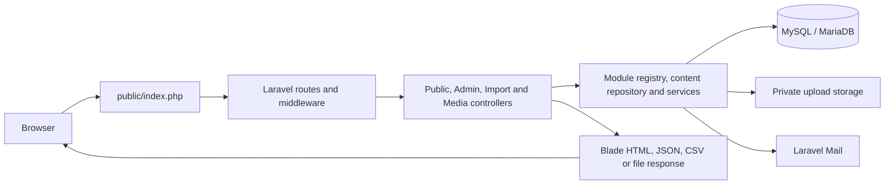

# Global Trade Lines — Laravel CMS

Global Trade Lines is a company website and content management system for presenting industrial and electrical products, brands, company information, brochures, careers and galleries, and collecting sales enquiries. Staff manage the website through a custom administration interface without editing templates or database records directly.

The application runs on **Laravel 13**, with **13.37.0** currently pinned in [composer.lock](composer.lock). It replaces the earlier native PHP runtime while retaining the CMS schema, public design and editorial workflows. The admin is custom-built; no prebuilt admin template is used. The sign-in and password-reset screens use the supplied animated design, and the company logo appears there and in the admin sidebar.

## Contents

- [Project scope and content](#project-scope-and-content)
- [Technical stack and requirements](#technical-stack-and-requirements)
- [Architecture](#architecture)
- [Key features](#key-features)
- [Setup and installation](#setup-and-installation)
- [Configuration](#configuration)
- [Using the CMS](#using-the-cms)
- [HTTP routes and API behaviour](#http-routes-and-api-behaviour)
- [Testing and verification](#testing-and-verification)
- [Deployment and maintenance](#deployment-and-maintenance)
- [Troubleshooting](#troubleshooting)
- [Contribution guidelines](#contribution-guidelines)
- [Further documentation](#further-documentation)

## Project scope and content

This is a catalogue and enquiry website. It does not implement customer accounts, a shopping cart, checkout or payment processing. Careers link to an email address or external application URL; there is no CV-upload or application-storage module. Gallery records can link to social profiles and posts, but social feeds are not fetched automatically.

The supplied source contained Django/Wagtail frontend templates, styles, scripts, logos and favicons, but no original backend, business database export or uploaded media. The Laravel application includes converted Blade views and recovered template content. Products, brands, classifications, brochures, gallery content and vacancies must be supplied by the business. Missing legal pages are seeded as drafts.

Recovered statistics, certification statements, contact details and the founding year are editable source claims that require owner review. The dashboard counts actual database records, which can differ from manually entered homepage statistics. Unknown historical URLs cannot be reconstructed from the available templates. See [content migration boundaries](docs/CONTENT-MIGRATION.md) before launching or replacing an existing site.

## Technical stack and requirements

| Component | Implementation / requirement |
| --- | --- |
| Backend | PHP **8.3+** and Laravel **13**; exact dependencies are locked by Composer |
| Database | MySQL **8+** or MariaDB **10.4+**, using InnoDB and `utf8mb4` |
| Rendering | Blade templates with application helpers and server-rendered forms |
| Frontend | HTML, custom CSS and JavaScript; public templates load Bootstrap **5.3.3**, Font Awesome **6.5.2** and Google Fonts |
| Authentication | Laravel session guard, Eloquent administrator/role models, Gates and bcrypt password hashing |
| Storage | Local private uploads through Laravel Storage; public static assets under `public/assets/` |
| Sessions / cache | File-backed by default; array stores are used in framework tests |
| Email | Laravel Mail with SMTP, log and array transports; application mail is disabled by default |
| Development tools | Composer 2; PHPUnit **12.5-compatible** dependency constraint, Mockery and Collision |
| Optional browser QA | Node.js, Playwright and its Chromium browser |
| Web serving | Apache with rewrite support and PHP 8.3+, or Artisan's development server locally |

Enable PHP extensions required by Composer and the application, including PDO/PDO MySQL, mbstring, DOM/XML, fileinfo, cURL, OpenSSL, tokenizer and sessions, together with PHP's standard Ctype, Filter, Hash and PCRE facilities. Run `composer check-platform-reqs` to check the installed dependency requirements against the active PHP runtime.

The baseline migration explicitly requires MySQL/MariaDB. The SQLite connection present in configuration does **not** make SQLite a supported CMS installation target.

There is **no Node/npm or frontend build step for normal installation**. Assets are served directly. The implemented workflows do not require Redis, a queue worker or a scheduled publishing job: publication dates are checked when content is queried, and email is sent synchronously. Public styling, fonts and the seeded external hero image still depend on their external providers unless replaced or hosted locally.

## Architecture



### Request and application layers

- [routes/web.php](routes/web.php) defines named public and admin routes. [bootstrap/app.php](bootstrap/app.php) registers routing, exception rendering, the `/up` health route and CMS middleware.
- Web requests use Laravel sessions and CSRF protection. `CmsState` resets request-local service state and adds response headers; `EnsureInstalled` shows the setup screen with HTTP 503 until an installation marker exists.
- `cms.auth` requires an active administrator session. `cms.module` and controller checks enforce permissions through Laravel Gates. Admin responses use private, non-cacheable headers.
- Controllers coordinate rendering and actions. [Modules.php](app/Models/Modules.php) is a closed registry of module names, fields, relationships, permissions and editor options; request input does not define database identifiers.
- [Content.php](app/Models/Content.php) handles draft overlays, publication visibility, revisions, transactions, protected deletions and version checks for concurrent edits. `ContentRecord` provides Eloquent lookups; the `App\Core\DB` adapter uses Laravel's database connection for the existing relational schema.
- Services implement navigation, settings, media validation and delivery, rich-text sanitization, record validation, rate limits, audit logging and mail. Views use shared helpers from [app/Support/helpers.php](app/Support/helpers.php).

The application has one Laravel runtime. It does not embed the old native router, PHP session system or `app/bootstrap.php` entry point.

### Data and filesystem layout

Content is stored in related tables for pages/sections/slides, navigation and mega menus, catalogue records, gallery, careers, brochures, enquiries, media, users and roles. Supporting tables hold settings, drafts, revisions, permissions, password-reset tokens, rate limits, activity logs and the installation marker. Laravel tracks migrations separately. Application and database time handling use **UTC**.

```text
app/
  Console/Commands/       Installation and administrator password recovery
  Http/Controllers/       Public, admin, import and media request handling
  Http/Middleware/        Installation state, authentication and authorization
  Models/                Eloquent models, module registry and content repository
  Services/              Validation, media, navigation, mail and other CMS services
  Support/               Shared application/view helpers
bootstrap/               Laravel bootstrap and generated framework caches
config/                  Application, database, mail, session and storage settings
database/
  migrations/            Fresh schema creation and compatible native-schema adoption
  schema/                Baseline schema and recovered-content SQL
  seeders/               Guarded seeding through Laravel
docs/                    Operational, editorial and migration guides
public/                  The web server document root
  assets/                CSS, JavaScript, company logo and favicon files
resources/views/         Public and admin Blade templates
routes/                  Web routes and console route file
storage/                 Private uploads, logs, sessions and generated files
tests/                   PHPUnit, HTTP, installation and browser checks
tools/                   Windows PHP wrapper and release packaging script
```

Uploaded files live in `storage/app/private/uploads/YYYY/MM/` and are delivered through `/media/{id}` after access/publication checks. Built-in logo/favicon assets remain ordinary public files. Do **not** expose private uploads with `php artisan storage:link`.

## Key features

| Area | Supported features |
| --- | --- |
| Pages and homepage | Reusable sections, hero slides/images/video, rich text, calls to action, statistics, trust badges and manual or catalogue-driven content |
| Publishing | Separate working drafts, publish/unpublish, future publication times, authenticated page/product previews, revision restoration and conflict detection |
| Navigation and footer | Nested menus, mega-menu groups, record selectors, automatic catalogue groups, device visibility, ordering and footer/legal-link areas |
| Catalogue | Brands, categories, subcategories, optional subcategory-brand associations, products, additional images, specifications, featured flags and search/filter views |
| CSV | Product export and validated import preview with explicit update confirmation; enquiry export; protection against spreadsheet formula injection in exports |
| Media | Multiple uploads, drag/drop, progress, search/type filters, metadata, replacement, reference tracking and deletion protection for files in use |
| Gallery and brochures | Albums, images/videos, lightbox presentation, outbound social links and publication-controlled brochure PDFs |
| Careers | Job descriptions, classifications, closing dates and email/external application links |
| Enquiries | Database persistence before notification, status/date filters, internal notes, CSV export and notification outcome tracking |
| Branding and SEO | Company/contact details, logos, theme colours, interface labels, social links, canonical/social metadata, structured data, sitemap and robots output |
| Administration | Real database counts, search, responsive sidebar, dark mode, custom authentication screens and company branding |
| Access control | Super Administrator, Content Editor, Product Manager and Enquiry Manager seed roles; editable permissions, user management and activity logs |

Security-related behaviour includes CSRF checks, login/reset/enquiry rate limits, sanitized rich text, validated URLs, parameterized database access, upload content/type checks and administrator session invalidation after account/password changes. Password resets use hashed, single-use tokens valid for 30 minutes. The CMS protects the last active Super Administrator and blocks disabling or deleting your own active account.

Enquiry forms include a honeypot and minimum completion time, with optional Cloudflare Turnstile verification. Turnstile checks the configured hostname and `quote` action. These controls do not replace deployment testing or an independent security review.

## Setup and installation

### 1. Prepare PHP and dependencies

Extract or check out the application into a working directory. Run commands from the directory containing `artisan` and `composer.json`.

```bash
php -v
composer install
composer check-platform-reqs
```

Use PHP 8.3+ for both Composer and Artisan. A production release ZIP includes `vendor/`; Composer is needed when dependencies are absent, when updating them, or when installing development/test packages.

In this Windows workspace, the inspected XAMPP PHP 8.2 is too old. An independent PHP 8.4 runtime exists under `.tools/php84`; [tools/php.cmd](tools/php.cmd) selects it when available and otherwise uses `php` from `PATH`. It does not replace XAMPP, and PHP binaries are not included in release archives. For the workspace's Composer installation:

```powershell
.\tools\php.cmd -v
.\tools\php.cmd C:\ProgramData\ComposerSetup\bin\composer.phar install
.\tools\php.cmd C:\ProgramData\ComposerSetup\bin\composer.phar check-platform-reqs
```

### 2. Start MySQL/MariaDB and create an empty database

Create a database through your database client or phpMyAdmin, for example:

```sql
CREATE DATABASE globaltradelines
  CHARACTER SET utf8mb4 COLLATE utf8mb4_unicode_ci;
```

Use an account with the necessary schema-creation and application data permissions. The example port is **3308** because other services occupied 3306 and 3307 in the inspected development environment. Configure the port your database actually uses; changing `.env` does not change the database server's listening port.

XAMPP may provide MariaDB while Artisan uses the independent PHP runtime. XAMPP Apache is unnecessary for `artisan serve`, although phpMyAdmin may need it.

### 3. Create and configure `.env`

Copy [.env.example](.env.example) to `.env` only for a new installation. Preserve an existing `.env` and application key when updating a working Laravel site.

PowerShell:

```powershell
if (-not (Test-Path .env)) { Copy-Item .env.example .env }
notepad .env
```

Linux/macOS shell:

```bash
test -f .env || cp .env.example .env
```

Set the actual database host, port, name and credentials. For local use, set `APP_URL=http://127.0.0.1:8013` and keep `MAIL_ENABLED=false` until mail is configured. Make `storage/` and `bootstrap/cache/` writable by the PHP process.

### 4. Install the CMS and start the local server

For a **fresh, empty database**:

```bash
php artisan key:generate
php artisan cms:install
php artisan serve --host=127.0.0.1 --port=8013
```

In the supplied Windows workspace, use the equivalent commands:

```powershell
.\tools\php.cmd artisan key:generate
.\tools\php.cmd artisan cms:install
.\tools\php.cmd artisan serve --host=127.0.0.1 --port=8013
```

The installer runs migrations and recovered-content seeding, then prompts for the first administrator's name, email and a **12–72 character password**. Optional `--name` and `--email` flags prefill those fields; the password is entered privately. No default administrator or password is shipped. The installer refuses to overwrite an installed CMS. No manual SQL import is required.

Open the website at **http://127.0.0.1:8013/** and sign in at **http://127.0.0.1:8013/admin/login**. Keep the server terminal open; stop it with Ctrl+C. On subsequent runs, start the database and run only `artisan serve`. Do not regenerate the key or repeat installation.

The **“Ready for your setup”** screen means the application is reachable but the selected database lacks the installation marker. Verify `.env`, clear stale configuration with `php artisan config:clear` if necessary, and run `cms:install` from the application directory for a fresh installation. For an existing site, verify its database selection and follow the migration/update procedure instead.

### Existing native PHP CMS installations

Read [the migration guide](docs/LARAVEL-MIGRATION.md) before switching an installed database. Back up the database, old `.env` and uploads, install Laravel separately, configure its environment and generate its initial Laravel key. Then run:

```bash
php artisan migrate --force
```

The baseline migration verifies and adopts the complete compatible native CMS schema without replacing content, IDs or password hashes. Partial/unrecognized schemas are rejected. Copy old `storage/uploads/` into Laravel's `storage/app/private/uploads/`; database media paths remain valid. Administrators sign in again because Laravel uses a different session cookie.

Do not run the fresh installer, `migrate:fresh`, `db:wipe`, or an initial SQL import over existing business content. The baseline migration intentionally refuses a destructive rollback; restore a protected backup to revert a deployment.

## Configuration

### Environment and runtime settings

| Variable(s) | Purpose and default/example |
| --- | --- |
| `APP_NAME` | Application name; defaults to `Global Trade Lines` |
| `APP_ENV` | `local` for development, `production` on the server, `testing` for isolated tests |
| `APP_KEY` | Laravel encryption key generated once for a new Laravel installation; keep private and stable |
| `APP_DEBUG` | Defaults to `false`; keep disabled on public deployments |
| `APP_URL` | Canonical base URL, including HTTPS and any deployment path; local example `http://127.0.0.1:8013` |
| `DB_CONNECTION` | Use `mysql` for both supported database servers |
| `DB_HOST`, `DB_PORT` | Database endpoint; example `127.0.0.1:3308` |
| `DB_DATABASE`, `DB_USERNAME`, `DB_PASSWORD` | Database name and credentials; use the complete cPanel-prefixed names on shared hosting |
| `SESSION_DRIVER`, `SESSION_LIFETIME` | Defaults `file` and `60` minutes; session files live under `storage/framework/sessions/` |
| `BCRYPT_ROUNDS` | Password-hashing cost; defaults to `12` (framework tests use `4` only for test speed) |
| `CACHE_STORE` | Defaults to `file`; configured stores are `file` and `array` |
| `LOG_LEVEL` | Defaults to `warning`; application log is `storage/logs/laravel.log` |
| `MAIL_ENABLED`, `MAIL_MAILER` | Defaults `false` and `log`; use `true` and `smtp` for actual email sending |
| `MAIL_HOST`, `MAIL_PORT`, `MAIL_USERNAME`, `MAIL_PASSWORD` | SMTP connection details; default example port `587` |
| `MAIL_SCHEME` | Optional SMTP transport scheme read by `config/mail.php`; set according to the provider, e.g. `smtps` for implicit TLS |
| `MAIL_FROM_ADDRESS`, `MAIL_FROM_NAME` | Sender identity; replace the example address before enabling email |
| `TURNSTILE_SECRET` | Private Cloudflare Turnstile key, paired with the site key in admin settings |
| `UPLOAD_MAX_MB` | Per-file application upload limit; default `25`, constrained by the application to 1–100 MB |

`config/database.php` also supports `DB_URL` and `DB_SOCKET` when needed. Keep these consistent with the individual connection fields. `APP_URL` influences generated links, cookie security/path and Turnstile hostname verification. Application dates and publishing times are UTC.

After changing an environment value on a deployment with cached configuration, rebuild that cache with `php artisan config:cache`. For local diagnosis, `php artisan config:clear` makes Laravel read `.env` again.

### Admin-managed website settings

Use **Company Information**, **Contact Information**, **Header Settings**, **Footer Management**, **Appearance**, **SEO**, **Integrations** and **Website Labels** for editable business content and supported presentation options. Social accounts are managed through **Social Media**. These settings live in the database, not `.env`.

Set the enquiry notification recipient in Contact Information. Integrations supports a Google Analytics `G-...` measurement ID and the public Turnstile site key; the Turnstile secret stays in `.env`. SEO controls indexing, default metadata and social imagery. Review legal pages and business claims before enabling indexing.

### Uploads and mail

Recommended PHP settings for the default upload limit:

```ini
file_uploads=On
upload_max_filesize=25M
post_max_size=100M
max_file_uploads=20
```

Set a writable `upload_tmp_dir` in the PHP runtime actually serving requests. PHP/web-server limits can reject an upload before the application's validation runs. Allowed media types are JPEG, PNG, WebP, GIF, PDF, MP4 and WebM. The server checks extension, MIME type, size and relevant signatures; images above 60 megapixels and SVG/executable files are rejected. Replacements must retain the existing MIME type.

Mail outcomes are `disabled`, `logged`, `accepted` or `failed`. `accepted` means the SMTP transport accepted the message, not that it reached the recipient's inbox. Log transport records messages locally and does not deliver them. An enquiry is stored even when its notification fails.

Email password recovery requires configured mail. For administrator recovery from the command line:

```bash
php artisan cms:reset-password
```

This prompts for the existing account and a new password, then invalidates its previous sessions.

## Using the CMS

1. Sign in at `/admin/login` with the administrator created during installation.
2. Review company/contact settings, logos, notification email, source claims and website labels.
3. Create brands and categories, then subcategories and products. A product's selected subcategory must belong to its category. Add images and specifications after saving the product.
4. Build pages and homepage sections; configure navigation, mega menus and footer links using record selectors.
5. Add gallery albums/items, brochure PDFs and job openings as needed.
6. Preview pages/products, publish reviewed content and verify public navigation, forms and media.
7. Manage enquiries and internal notes; assign staff roles according to their responsibilities.

### Publishing rules

**Save draft** preserves a working copy without replacing the live record. **Publish changes** updates that record's live values, **Unpublish** hides it, and a future **Publish on (UTC)** date delays visibility. Revision restoration creates a draft for review. Draft previews require an authenticated user with permission and are marked noindex.

Drafts are **per record**: publishing a page does not publish its sections, slides or items automatically. Parent publication controls access to associated content. Navigation, settings, ordering, media metadata/replacement and product image/specification associations save immediately. Replacing a shared file affects all references; upload a separate file when preparing a draft that must leave live imagery unchanged.

### Product CSV workflow

Export `/admin/products/export` to obtain the supported headings:

```csv
brand,category,sub_category,product,slug,image,description,badge,external_url,button_label,sort_order,is_active,is_featured
```

Create classifications and upload images first. Classification values can identify titles or unique slugs; `image` identifies an existing media ID or unambiguous original filename, not a remote download. `product` is required; `slug` identifies an existing product, or is generated from its title. `is_active=1` publishes a record and `0` makes it unpublished.

Import accepts at most **1,000 rows / 2 MB**. Review the preview and validation errors before confirming; the preview expires after **30 minutes**. Updates require the separate confirmation checkbox and are checked for changes made since preview. CSV covers catalogue fields, not a complete backup of SEO, revisions, extra images or specifications.

See [the admin guide](docs/ADMIN-GUIDE.md) for detailed workflows and permission implications.

## HTTP routes and API behaviour

The CMS is a server-rendered application with a few JSON endpoints for its own admin interface. It does **not** provide a versioned public REST API, API tokens or a separate `routes/api.php` interface. Route definitions are in [routes/web.php](routes/web.php); use `php artisan route:list` to inspect the installed application.

### Public routes

| Method | Path | Behaviour |
| --- | --- | --- |
| GET | `/` | Published homepage |
| GET | `/{slug}` | Published page; seeded examples include `/about`, `/products`, `/brands`, `/careers`, `/gallery`, `/brochures` and `/contact` |
| GET | `/products/{slug}` | Published product detail |
| GET | `/product/{slug}` | Retained product-detail alias |
| GET | `/search?q=...&page=...` | Paginated search across published products, brands, categories, subcategories and pages |
| POST | `/enquiry` | Session/CSRF-protected enquiry submission, followed by a contact-page redirect |
| GET | `/media/{id}` | File delivery when authorized or referenced by publicly accessible content; supports range requests |
| GET | `/brochures/{id}/pdf`, `/brochures/{id}/download` | Published brochure file response; both routes use the media-serving logic |
| GET | `/sitemap.xml`, `/robots.txt` | Generated indexing output |
| GET | `/up` | Laravel application health route; not a full CMS/database readiness check |

The product listing supports `brand`, `category`, `sub_category`, `q`, `view` and `page`. Classification filters accept IDs, titles or slugs. `view` accepts `products`, `brands`, `categories` or `sub_categories`. Brochure filters accept brand/category IDs, `q` and `page`. Page availability depends on the database and publishing state; a URL alone does not create a page.

Enquiry fields are `name`, `email` and `message` (required), plus optional `phone`, `company` and `requirement`. Browser forms also supply `_token`, the empty `website_url` honeypot, and `cf-turnstile-response` when Turnstile is enabled. The form establishes session timing, so this endpoint is not an anonymous JSON ingestion API.

### Administration routes

| Method | Path | Behaviour |
| --- | --- | --- |
| GET, POST | `/admin/login` | Sign-in form and authentication |
| GET, POST | `/admin/forgot-password`, `/admin/reset-password` | Password recovery and token submission |
| GET | `/admin` | Dashboard |
| POST | `/admin/logout` | Sign out and invalidate the current session |
| GET, POST | `/admin/password` | Current administrator password change |
| GET | `/admin/search?q=...` | Search permitted modules |
| GET | `/admin/homepage`, `/admin/navigation`, `/admin/footer` | Content/menu builders |
| GET, POST | `/admin/settings/{group}` | Read/save a supported settings group |
| GET | `/admin/{module}` | Module list with applicable search/filter parameters |
| GET, POST | `/admin/{module}/{id}` | Edit/save a record; use `new` for creation where supported |
| POST | `/admin/{module}/{id}/{action}` | Supported `delete`, `duplicate` or `restore` action |
| GET | `/admin/preview/{module}/{id}` | Authorized draft preview for `pages` or `products` |
| GET, POST | `/admin/import` | Product CSV upload, preview and commit |
| GET | `/admin/products/export`, `/admin/enquiries/export` | CSV downloads |

Other than login/recovery, these routes require a session and appropriate permissions. Valid module keys come from `Modules`, for example `pages`, `page_sections`, `products`, `brands`, `categories`, `subcategories`, `media_files`, `gallery_albums`, `gallery_items`, `brochures`, `career_jobs`, `enquiries`, `admin_users` and `roles`. Read-only modules and restricted actions remain protected even though routes share generic patterns.

Settings group keys are `company`, `contact`, `header`, `footer`, `appearance`, `seo`, `integrations` and `text`. Module forms use registered field names and an `intent` such as `draft`, `publish`, `unpublish` or `save`; existing-record forms include `_version` for conflict detection. Revision restoration includes `revision_id`. Keep these form values when extending the admin interface.

### Admin JSON helpers

| Method and path | Inputs | Successful response |
| --- | --- | --- |
| GET `/admin/options` | `table` and optional `q`; relation browsing must be permitted | `{"options":[{"id":1,"label":"Example"}]}` |
| POST `/admin/upload` | Multipart `files[]`, CSRF token; optional `replace_id`, `album_id` or `product_id`; send `Accept: application/json` | `{"files":[{"id":1,"title":"Example","url":"/media/1"}],"errors":[]}` |
| POST `/admin/{module}/reorder` | Ordered `ids[]` and CSRF token | `{"ok":true,"message":"Order saved."}` |

Requests use the same session cookie and CSRF protections as admin forms. Upload batches may contain successful files and errors together; inspect both arrays. A batch with file errors returns HTTP 422. Gallery batches create draft items; product-image associations save immediately.

Typical responses include 303 redirects after forms or for unauthenticated admin access, 403 for permission failures, 404 for missing/unavailable content, 409 for an edit conflict, 419 for a CSRF/session mismatch, 422 for validation and 429 for rate limiting. CMS exceptions requested as JSON use `{"error":"..."}`; Laravel validation responses can instead contain `message` and `errors`. Clients should inspect status and response type rather than assume every failure is JSON.

## Testing and verification

Install development dependencies with `composer install`. Production archives contain only production dependencies. Tests need a working MySQL/MariaDB server; they do not use SQLite.

Use a **separate test copy/environment** with disposable data. Create `gtl_laravel_test` for HTTP/browser checks and `gtl_laravel_phpunit_test` for PHPUnit. In that copy's `.env`, set `APP_ENV=testing`, `DB_DATABASE=gtl_laravel_test`, the test server credentials, `MAIL_ENABLED=false` and a local `APP_URL`. Generate its key and run `cms:install` to create a test-only administrator. Clear any cached configuration before selecting the test environment.

| Suite | Command | Scope / prerequisites |
| --- | --- | --- |
| Framework | `php artisan test --compact` or `composer test` | `phpunit.xml` forces `gtl_laravel_phpunit_test`; server credentials come from the environment; setup seeds it if needed and each test rolls back its transaction |
| Installation/migration | `php tests/installation.php` | Creates and drops randomly named `gtl_install_*_test` databases; test account needs database creation/deletion permissions |
| HTTP integration | `php tests/integration.php` | Running test application, installed `*_test` database and test administrator credentials |
| Browser | `node tests/browser.cjs` | Same running test application plus Node, Playwright and Chromium |

Start the test application's server, for example:

```bash
php artisan serve --host=127.0.0.1 --port=8013
```

Use another free port in both `APP_URL` and the server command if a development instance already uses 8013. For browser tests, also set `TEST_BASE_URL` to that same URL; the HTTP suite reads `APP_URL`.

In another **PowerShell 7.1+** terminal in the test copy:

```powershell
$env:TEST_ADMIN_EMAIL='your-test-admin@example.test'
$env:TEST_ADMIN_PASSWORD=Read-Host 'Test administrator password' -MaskInput
.\tools\php.cmd tests\integration.php
node tests\browser.cjs
```

For other shells, provide those variables through a private process environment or test runner. `PLAYWRIGHT_PACKAGE` can point to an existing Playwright module; otherwise the browser script loads `playwright` through Node module resolution. Install Playwright and its Chromium browser in the development/test environment. The legacy private `storage/test-access.json` fallback, if present, takes precedence in the HTTP suite, so ensure it belongs to the test environment or use a clean test copy.

Database-name guards require a name ending in `_test`; the browser script also checks the test copy's `.env` directly. HTTP/browser suites create and clean up fixture records and must not run concurrently against the same test database. Never point their URL at a production site. Reports and screenshots under private `storage/` are development artifacts.

Recorded verification in [docs/TESTING.md](docs/TESTING.md), dated 16 October 2026, includes **190 HTTP checks**, **7 PHPUnit tests / 29 assertions**, **13 installation/migration checks**, and **30 browser checks/observations**, plus responsive and syntax checks. It used Laravel 13.37.0, PHP 8.4.26 and MariaDB 10.4.32. These are historical results, not a guarantee for another host or a claim that tests run automatically on installation. Live SMTP delivery, real Turnstile credentials, production cPanel hosting and unavailable business datasets still require deployment verification.

## Deployment and maintenance

### Apache or ServerByte cPanel shared hosting

1. Back up an existing site's database, private uploads and `.env`. Select PHP **8.3+** for the domain and verify the command-line PHP version separately.
2. Create the MySQL database and database user in cPanel and assign the required privileges. Use the full prefixed database/user names and the host's actual database endpoint in `.env`.
3. Upload the Laravel application outside the publicly served directory, for example `/home/CPANEL_USER/apps/globaltradelines`. Include hidden files such as `.htaccess`. Keep the environment file and private folders inaccessible from the web.
4. Set the domain/subdomain document root to that application's **`public/`** directory. The project-root `.htaccess` deliberately denies direct access; serving the application root is incorrect.
5. If cPanel fixes the document root at `public_html` or another directory, copy the **contents** of `public/` there. Update all application paths in that copied `index.php`—the maintenance file, `vendor/autoload.php` and `bootstrap/app.php`—to the private application folder. Keep assets synchronized with the copied public directory.
6. Configure a private production `.env`: `APP_ENV=production`, `APP_DEBUG=false`, the final HTTPS `APP_URL`, database credentials and any mail/integration settings. Preserve an existing Laravel `APP_KEY`; generate one only for a new Laravel installation. Make `storage/` and `bootstrap/cache/` writable by the PHP account.
7. Install production dependencies if they are not already included in the release:

   ```bash
   composer install --no-dev --optimize-autoloader
   composer check-platform-reqs --no-dev
   ```

8. In cPanel Terminal/SSH, enter the directory containing `artisan`. For a fresh database run `php artisan key:generate` and `php artisan cms:install`. For an existing compatible native database follow the migration guide; for an existing Laravel installation preserve its configuration/data and apply required migrations with `php artisan migrate --force`.
9. Clear stale deployment caches and build production caches after configuring the environment:

   ```bash
   php artisan optimize:clear
   php artisan optimize
   ```

10. Verify the homepage, administrator login, publication visibility, uploads, brochure downloads, enquiry persistence, password recovery and any enabled integrations on the final HTTPS hostname. Review legal content and indexing settings before launch.

The cPanel PHP executable may differ from `php`; on an EasyApache PHP 8.4 installation it is commonly `/opt/cpanel/ea-php84/root/usr/bin/php`. Use the actual PHP 8.3+ executable provided by the host. If Terminal/SSH is unavailable, ask the host to run the Artisan setup commands; there is no browser-based installer that replaces them. Do not use `artisan serve` as the production web server.

For Apache virtual-host configuration and additional hosting details, see [installation and deployment](docs/INSTALLATION.md). For the existing sign-in/sidebar design update, see [the cPanel update instructions](docs/ADMIN-DESIGN-UPDATE.md); that update needs no database migration or new application key.

### Releases, backups and operations

[tools/package.ps1](tools/package.ps1) stages a production release, installs dependencies with `--no-dev`, checks Laravel startup and Blade compilation, excludes local environment/runtime data and writes SHA-256 manifests. Run it from PowerShell with a suitable PHP/Composer installation, for example:

```powershell
.\tools\package.ps1 -PhpExecutable (Resolve-Path '.\.tools\php84\php.exe').Path -ComposerPhar 'C:\ProgramData\ComposerSetup\bin\composer.phar'
```

The script refuses to overwrite an existing release directory/archive; preserve or rename earlier artifacts before building again. Outputs include `release/global-trade-lines-laravel13.zip`, schema/seed SQL reference files and `release/LARAVEL-SHA256SUMS.txt`. The SQL files are not a substitute for a backup and should not be imported over an installed site.

Back up the **database, `storage/app/private/uploads/` and `.env` together**, keep backups outside the web root and test restoration. Preserve the application key across ordinary updates. Review `storage/logs/laravel.log`, mail outcomes and admin activity logs during operations. Rebuild relevant caches after configuration/view changes. There is no required background worker or cron job for the current synchronous CMS workflows.

## Troubleshooting

| Symptom | What to check |
| --- | --- |
| PHP/platform dependency error | Run `php -v` or `.\tools\php.cmd -v`; Composer, CLI and web PHP can be different. Use PHP 8.3+ and required extensions. |
| MySQL stops or connection is refused | Inspect the database server's error log, running services and actual port; keep server configuration, phpMyAdmin and `.env` consistent. The application port does not resolve a database-service crash. |
| “Ready for your setup” / HTTP 503 | Confirm database selection and clear stale config; install only into the intended fresh database or follow the existing-site migration procedure. |
| 403 at the project root | Point the web server at `public/`, not the Laravel application directory. |
| 500 response | Inspect `storage/logs/laravel.log`, database access, PHP version/extensions and writable directories; keep public debug output disabled. |
| 419 when submitting a form | Refresh the form and check hostname/HTTPS, session cookies, `APP_URL` and session-directory permissions. |
| Local port 8013 is busy | Select a free port in `artisan serve` and `APP_URL`; keep test URLs consistent too. |
| Upload fails | Check PHP request/file limits, `UPLOAD_MAX_MB`, allowed types, writable `upload_tmp_dir` and private storage permissions. |
| Email is not received | Check `MAIL_ENABLED`, SMTP transport/credentials, sender and notification recipient; `logged` is not delivery and `accepted` is not inbox confirmation. |
| Saved content is absent publicly | Check the record and parent publishing states, UTC publication date and separate child drafts. |
| Styles remain old after upload | Verify assets are in the actual document root, clear/rebuild Blade views and refresh the browser cache. |

## Contribution guidelines

The project is marked **proprietary** in `composer.json`. Obtain the owner's authorization before redistribution or external contribution; no open-source licence grant is implied.

1. Work in a separate branch or working copy and describe the problem and intended behaviour before making broad changes.
2. Follow the existing Laravel structure. Keep request coordination in controllers, CMS rules in the module registry/services, presentation in Blade/assets and secrets in environment configuration.
3. Use migrations for schema changes and keep existing-installation compatibility in mind. Preserve seeded/business content and avoid destructive rollback assumptions.
4. Enforce permissions and validation on the server. Use the registered fields/modules, escaped output, sanitized rich text, CSRF-protected mutations and private-media access rules.
5. Preserve publishing semantics, optimistic edit-conflict checks, supported routes, accessible controls and responsive layouts. Add targeted tests when changing behaviour; use disposable test data.
6. Run checks relevant to the change. Framework/HTTP tests cover backend changes; browser checks cover interactive workflows; installation checks matter for schema/seeding changes. Compile Blade views when modifying templates. Explain any unavailable verification.
7. Update this README and the relevant guide when setup, configuration, routes or editor behaviour changes. Keep dependency updates intentional and include `composer.lock` when dependencies change.
8. Exclude `.env`, credentials, runtime binaries, generated caches, logs, sessions, test reports, uploaded business files and `vendor/` from source changes. Share release archives separately.
9. Describe the final change, validation performed, migration requirements and any deployment considerations in the review request. Include screenshots for visible interface changes where useful.

No automated CI workflow or formatter configuration is included in the current project; use the documented local checks and existing code conventions.

## Further documentation

| Guide | Contents |
| --- | --- |
| [Installation](docs/INSTALLATION.md) | Windows runtime details, Apache/cPanel, uploads, email and troubleshooting |
| [Admin guide](docs/ADMIN-GUIDE.md) | Editorial workflows, catalogue, media, permissions and publishing rules |
| [Native-to-Laravel migration](docs/LARAVEL-MIGRATION.md) | Backup, compatible schema adoption and upload/session transition |
| [Content migration](docs/CONTENT-MIGRATION.md) | Recovered content, missing datasets, claims to review and preservation limits |
| [Testing](docs/TESTING.md) | Test setup, recorded results and verification limits |
| [Admin design update](docs/ADMIN-DESIGN-UPDATE.md) | Applying the supplied authentication design and company logo to an existing cPanel site |
| [Original source inventory](docs/IMPLEMENTATION-INVENTORY.md) | Historical template/component inventory and implementation reference |
